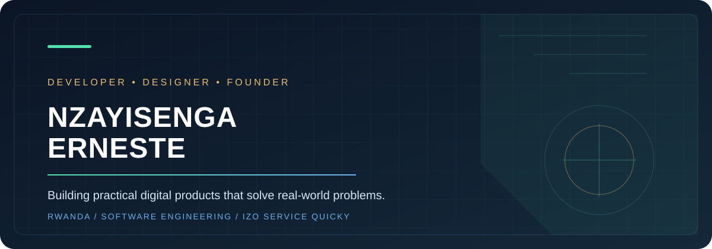
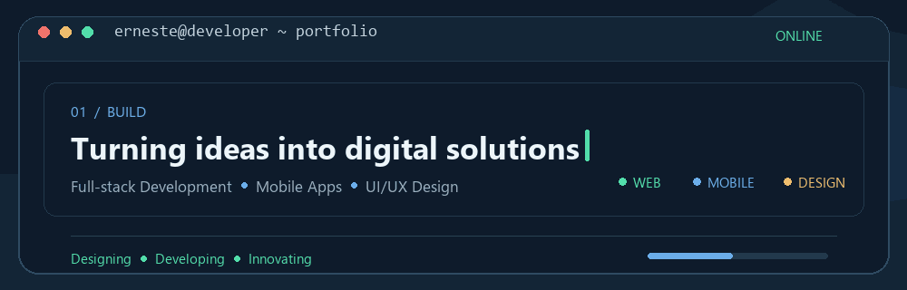
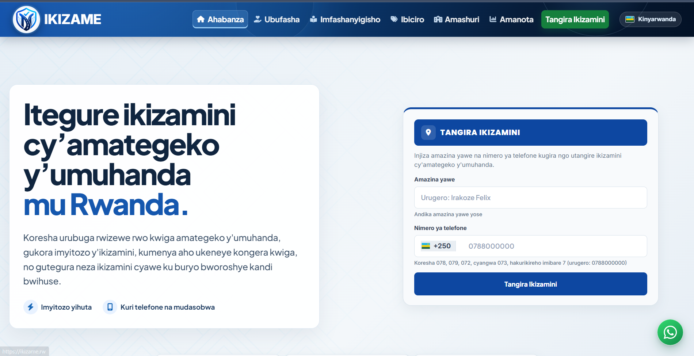
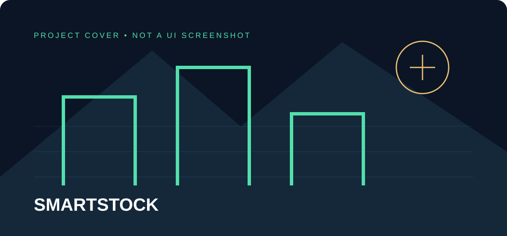
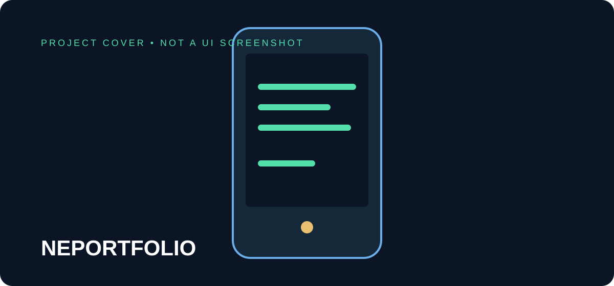
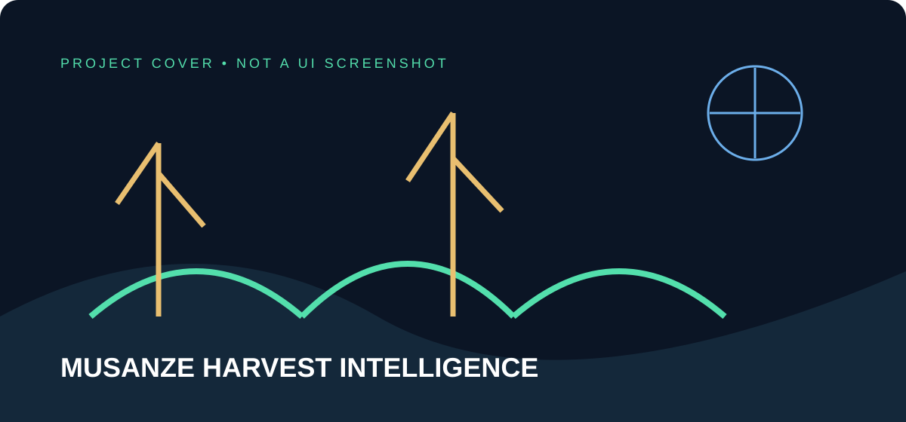

  
  
  

<strong>Rwanda · Final-year Software Engineering student at INES Ruhengeri · Founder of IZO SERVICE QUICKY</strong>

  

## About me

I am a Rwandan software developer building practical web and mobile products for real users. I work across full-stack development, deployment, interface design, and visual communication, with a focus on clear solutions rather than unnecessary complexity.

My current work combines software engineering, graphic design, and entrepreneurship through **IZO SERVICE QUICKY**, a digital services and creative technology business.

## Featured projects

### [ikizame.rw](https://ikizame.rw/) · Live product

<table>
  <tr>
    <td width="46%" valign="top"></td>
    <td valign="top">Online preparation platform for Rwanda’s provisional driving examinations, designed for phones and computers.  <strong>Role:</strong> Full-stack developer and maintainer <strong>Stack:</strong> Node.js · Express.js · MySQL · JavaScript · Nginx · PM2 <strong>Evidence:</strong> <a href="https://ikizame.rw/">Live website</a> · <a href="https://github.com/nzerneste250/ikizame-app">Source code</a></td>
  </tr>
</table>

### [SMARTSTOCK](https://github.com/nzerneste250/SMARTSTOCK) · Under development

<table><tr><td width="46%" valign="top"></td><td valign="top">Inventory and point-of-sale platform for small and medium-sized businesses in Rwanda. The repository describes products, stock, sales, receipts, and business monitoring workflows.  <strong>Stack:</strong> PHP · Laravel · Vite · Tailwind CSS · Axios <strong>Status:</strong> Under development; not presented as a launched commercial product.</td></tr></table>

### [NEPortfolio](https://github.com/nzerneste250/MOB_A2_2527341) · Academic mobile project

<table><tr><td width="46%" valign="top"></td><td valign="top">Personal Android portfolio application built with React Native, Expo, and TypeScript. It presents profile, education, skills, projects, and experience with offline support and editable local profile data.  <strong>Stack:</strong> React Native · Expo · TypeScript · React Navigation · AsyncStorage</td></tr></table>

### Musanze Harvest Intelligence Service · Academic prototype

<table><tr><td width="46%" valign="top"></td><td valign="top">SWE 3513 machine-learning decision-support prototype using synthetic agricultural data to explore harvest quantity, production risk, and farm similarity.  <strong>Stack:</strong> Python · NumPy · pandas · scikit-learn · FastAPI · Uvicorn · pytest <strong>Important:</strong> Classroom decision support only; data is synthetic and results require human review. No public repository link is claimed here.</td></tr></table>

## Technical expertise

| Development | Delivery | Design |
| --- | --- | --- |
| JavaScript · TypeScript · React · Next.js · Node.js · Express.js · PHP · Laravel · MySQL · React Native · Expo | Linux · Ubuntu · Nginx · PM2 · VPS deployment · Git · GitHub · REST APIs | UI/UX · Graphic design · Branding · Adobe Photoshop · Social media design |

## IZO SERVICE QUICKY

**IZO SERVICE QUICKY** is my digital services and creative technology business. It brings together website development, deployment and maintenance; graphic design, branding and social media visuals; online service assistance; and practical technology support for individuals and businesses.

## Education

**INES Ruhengeri** · Software Engineering · Final-year student · Rwanda

## Contact

  

Open to conversations about software projects, design work, collaborations, and opportunities.

<strong>Design · Build · Deliver</strong>
